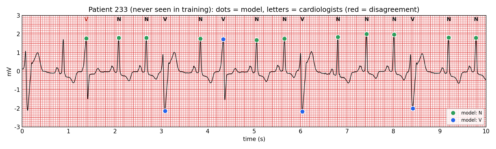
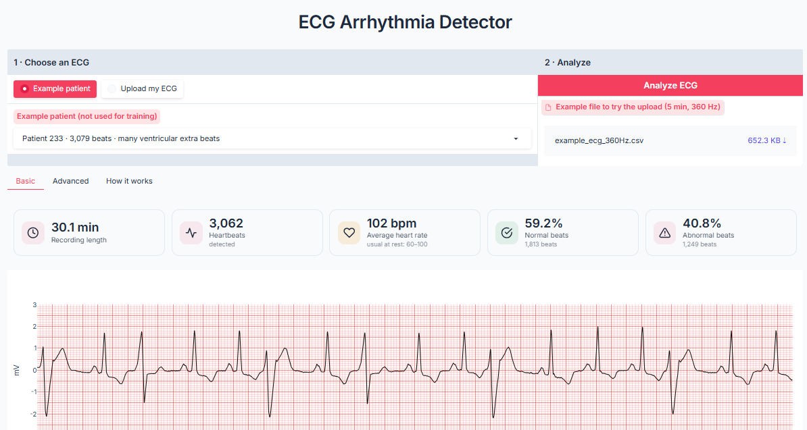
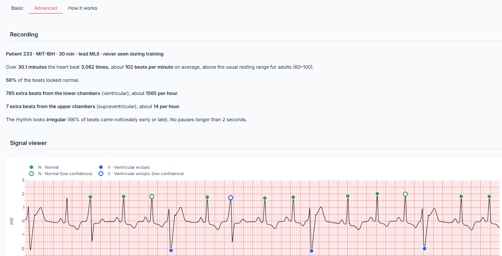
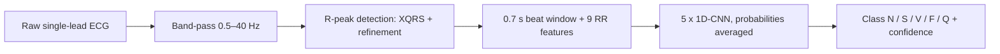
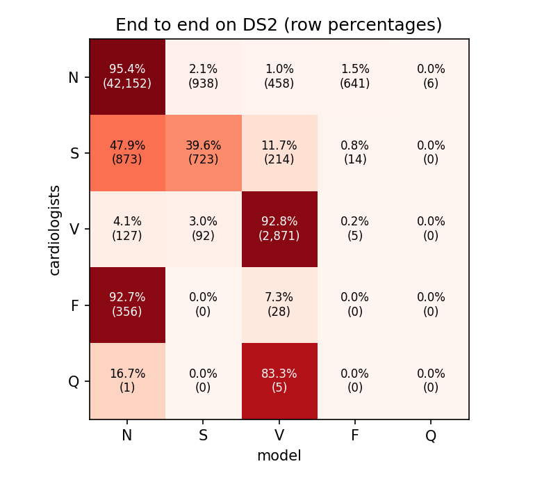

# ECG Arrhythmia Detector

Finds every heartbeat in a single-lead ECG and sorts it into the five AAMI classes (normal, supraventricular ectopic,
ventricular ectopic, fusion, unclassifiable). Tested on 22 patients the model never saw.

[](https://colab.research.google.com/github/fady-mostafa-omar/ecg-arrhythmia-detector/blob/main/notebooks/ecg_arrhythmia_detector.ipynb)
[](https://github.com/fady-mostafa-omar/ecg-arrhythmia-detector/actions/workflows/ci.yml)



## The app

Pick one of the 22 test patients or upload your own single-lead ECG (CSV, any sampling rate of at least 100 Hz).

| Basic: for anyone | Advanced: for clinicians and researchers |
|---|---|
|  |  |

- **Basic:** recording length, heartbeats, average heart rate, normal and abnormal beats, and the ECG on standard paper.
- **Advanced:** every beat colored by class (hollow = low confidence; hover for all class probabilities), heart rate
  and rhythm, beat-to-beat intervals, beat counts, agreement with the cardiologists, heart-rate variability, and a
  beat-by-beat CSV export.
- **How it works:** method, test results and limitations.

**Try it:** open the [Colab notebook](https://colab.research.google.com/github/fady-mostafa-omar/ecg-arrhythmia-detector/blob/main/notebooks/ecg_arrhythmia_detector.ipynb) and run sections 0 and 1. It prints a temporary public link
to the app, which stays active while that cell runs. If the link cannot be created (Gradio's link service is sometimes down),
run the notebook's next cell instead: it opens the app through Colab.

## Problem

An extra (ectopic) heartbeat can be harmless or a sign of heart disease, and a 24-hour Holter recording holds about
100,000 beats, far too many to review by hand. Automatic beat classifiers often report accuracies above 99%, but most
of those numbers come from intra-patient splits, where beats from the same person appear in both the training and the
test data. On new patients, performance drops sharply (de Chazal et al., 2004). This project builds a small,
CPU-friendly classifier, evaluates it only on unseen patients, and measures the whole chain from the raw signal,
including beat detection.

## Data

[MIT-BIH Arrhythmia Database v1.0.0](https://physionet.org/content/mitdb/1.0.0/) (PhysioNet): 48 half-hour,
two-channel ambulatory ECG recordings from 47 people, sampled at 360 Hz, with every beat labeled by cardiologists.
License: Open Data Commons Attribution v1.0. The data is not stored in this repository; `scripts/download_data.sh`
downloads it.

- Lead MLII is used (record 114 stores it in its second channel).
- The four paced records (102, 104, 107, 217) are excluded, following AAMI EC57.
- Inter-patient split (de Chazal et al., 2004): DS1 for training, DS2 for testing, 22 records each, no person in both.

| Split | N | S | V | F | Q | Total |
|---|---|---|---|---|---|---|
| DS1 | 45,824 | 943 | 3,788 | 414 | 8 | 50,977 |
| DS2 | 44,218 | 1,836 | 3,219 | 388 | 7 | 49,668 |

## Method



- **Beat window:** 0.7 s around each R peak (0.25 s before, 0.45 s after), band-passed 0.5–40 Hz.
- **Timing features:** 9 RR-interval features (previous, next, local mean and recording mean, plus their ratios).
  Arriving early is a key sign of an ectopic beat.
- **Model:** a compact 1D-CNN (three convolution blocks) on the waveform, fused with the RR features
  (18,309 parameters). Class-weighted cross-entropy (1/√class count), amplitude-jitter and
  noise augmentation, Adam, 15 epochs.
- **Model selection (DS1 only):** 17 DS1 patients train the network; the other 5 (106, 122, 203, 205, 223) choose
  the epoch with the best mean F1 of N, S and V. DS2 is used only for the final test.
- **Shipped model:** the average of 5 networks trained with different random seeds
  (91,545 parameters). This choice was fixed before the ensemble was evaluated.
- **R-peak detection:** WFDB's XQRS detector; each peak is then moved to the largest absolute amplitude within ±100 ms.
- **Baselines:** linear discriminant analysis and gradient boosting on hand-crafted RR and morphology features.

## Results

All numbers are on DS2: 22 patients never used for training or model selection. Se = sensitivity,
PPV = positive predictive value, both in %. Labeling every beat "normal" would already give 89.0% accuracy,
which is why accuracy is not reported.

**Beat classification at the cardiologists' beat positions** (Se / PPV):

| Class | DS2 beats | LDA | Gradient boosting | CNN, single model (mean ± SD, 5 seeds) | **CNN ensemble (shipped)** |
|---|---|---|---|---|---|
| N | 44,218 | 97.6 / 95.6 | 80.0 / 96.6 | 93.6 ± 3.4 / 96.7 ± 0.6 | **95.5 / 96.7** |
| S | 1,836 | 22.5 / 35.4 | 38.1 / 20.2 | 40.0 ± 4.3 / 41.0 ± 3.2 | **38.8 / 41.8** |
| V | 3,219 | 77.3 / 92.2 | 96.7 / 39.3 | 90.1 ± 5.2 / 74.8 ± 17.6 | **92.3 / 82.6** |
| F | 388 | 3.9 / 2.4 | 0.3 / 0.1 | 6.3 ± 10.3 / 1.6 ± 2.0 | **0.3 / 0.1** |

**End to end** (raw ECG → our R-peak detector → classifier, matched to the cardiologists' beats within 150 ms):

| Class | DS2 beats | CNN, single model (mean ± SD) | **CNN ensemble (shipped)** | Ensemble F1 |
|---|---|---|---|---|
| N | 44,195 | 93.4 ± 3.6 / 96.9 ± 0.5 | **95.4 / 96.9** | 96.1 |
| S | 1,824 | 41.6 ± 3.9 / 40.7 ± 2.5 | **39.6 / 41.2** | 40.4 |
| V | 3,095 | 90.3 ± 4.9 / 72.7 ± 18.0 | **92.8 / 80.3** | 86.1 |
| F | 384 | 5.9 ± 9.7 / 1.4 ± 1.8 | **0.0 / 0.0** | 0.0 |

- **R-peak detection:** Se 99.66%, PPV 99.88% (167 missed and 58 extra
  out of 49,712 beats).
- **Normal beats labeled abnormal:** 4.6% (2,043 of
  44,195): 938 as S, 458 as V, 641 as F, 6 as Q.
- **Size and speed:** 91,545 parameters (5 × 18,309);
  1.3 ms per beat on a Google Colab CPU, so a 30-minute recording takes a few seconds.



**Model-selection history, reported for transparency.** The first version chose the epoch by the mean F1 of S and V
only. That rule did not account for normal beats directly, and over 5 seeds some runs mislabeled many of them
(normal-beat sensitivity 87.9 ± 7.5%). The rule was changed to include N, and the 5-seed
ensemble was adopted before it was evaluated. Both versions were tested on DS2 (end to end, Se / PPV, mean ± SD over
5 seeds):

| Class | Rule: F1 of S and V | Rule: F1 of N, S and V (current) |
|---|---|---|
| N | 87.9 ± 7.5 / 97.2 ± 0.1 | 93.4 ± 3.6 / 96.9 ± 0.5 |
| S | 44.5 ± 5.3 / 38.6 ± 7.9 | 41.6 ± 3.9 / 40.7 ± 2.5 |
| V | 93.7 ± 2.1 / 71.7 ± 6.6 | 90.3 ± 4.9 / 72.7 ± 18.0 |
| F | 30.7 ± 35.9 / 2.8 ± 1.8 | 5.9 ± 9.7 / 1.4 ± 1.8 |

**Reported in the literature** (not reproduced here; evaluation details differ, so this is for orientation only):

| Study | Method | S (Se / PPV) | V (Se / PPV) |
|---|---|---|---|
| de Chazal et al., 2004 | Linear discriminants, same DS1/DS2 split | 75.9 / 38.5 | 77.7 / 81.9 |

Studies that put beats from the same patients in both training and test sets often report accuracies above 99%;
those numbers are not comparable with the inter-patient results above.

## Limitations

- Trained and tested on MIT-BIH only: 47 people recorded in 1975–1979 with one type of recorder and lead MLII.
  Other devices and leads (for example, smartwatches) are untested.
- S beats: the model finds about 4 in 10. One DS2 patient
  (record 232) holds 76% of all DS2 S beats, so the S result mostly reflects
  that patient.
- F beats are not recognized (0.0% sensitivity); they are only 0.8% of the training beats.
- About 5 in 100 normal beats are labeled abnormal, so the app overestimates the
  abnormal share in mostly normal recordings.
- Errors are uneven across patients. In record 233, the default example in the app, the cardiologists label
  72% of the beats normal but the app shows 59%: 462 normal beats are labeled abnormal,
  455 of them as F.
- The epoch is chosen on only 5 validation patients, so single runs vary (see the SD values); the ensemble reduces
  but does not remove this.
- Research and education tool, not a medical device.

## How to run

**Google Colab:** open the notebook with the badge above. Section 0 installs everything and downloads the data, section 1 starts the app, and section 2 reproduces every result.

**Local:**

```bash
git clone https://github.com/fady-mostafa-omar/ecg-arrhythmia-detector.git
cd ecg-arrhythmia-detector
pip install -r requirements.txt
bash scripts/download_data.sh      # MIT-BIH into data/mitdb (about 100 MB)
python scripts/build_dataset.py    # beats -> data/beats_mitdb.npz
python scripts/baseline.py         # classical baselines
python scripts/train_cnn.py        # optional: retrain the ensemble (about 30 min on CPU)
python scripts/evaluate.py         # DS2 results -> results/
python app/app.py                  # app at http://127.0.0.1:7860
python -m pytest -q                # unit tests
```

All parameters are in `configs/default.yaml`.

```
configs/default.yaml   all parameters
src/ecgsuite/          beats, features, R-peak detection, CNN, pipeline, evaluation
scripts/               download, build dataset, baselines, train, evaluate
app/app.py             Gradio app (Basic, Advanced, How it works)
models/beatnet.pt      trained 5-seed ensemble (0.4 MB)
results/               tables and figures written by the scripts
notebooks/             Colab notebook
tests/                 unit tests, run by CI on every push
```

## Re-implementation note

This is a 2026 re-implementation, on public data only, of the heartbeat-classification part of an ECG project carried
out at the AI Hub for Sustainable Development (CINECA) in 2025. No data or code from the original project is included.

## Citations

- G. B. Moody and R. G. Mark, "The impact of the MIT-BIH Arrhythmia Database," *IEEE Eng. Med. Biol. Mag.*,
  vol. 20, no. 3, pp. 45–50, 2001.
- A. L. Goldberger et al., "PhysioBank, PhysioToolkit, and PhysioNet," *Circulation*, vol. 101, no. 23,
  pp. e215–e220, 2000.
- P. de Chazal, M. O'Dwyer, and R. B. Reilly, "Automatic classification of heartbeats using ECG morphology and
  heartbeat interval features," *IEEE Trans. Biomed. Eng.*, vol. 51, no. 7, pp. 1196–1206, 2004.
- ANSI/AAMI EC57, *Testing and reporting performance results of cardiac rhythm and ST segment measurement algorithms*.
- WFDB Software Package for Python: https://github.com/MIT-LCP/wfdb-python

## License

Code: MIT. Data: MIT-BIH Arrhythmia Database, Open Data Commons Attribution License v1.0 (not redistributed here).
